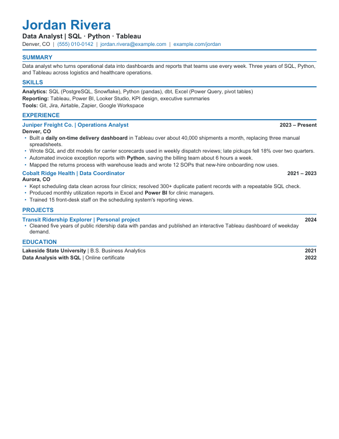
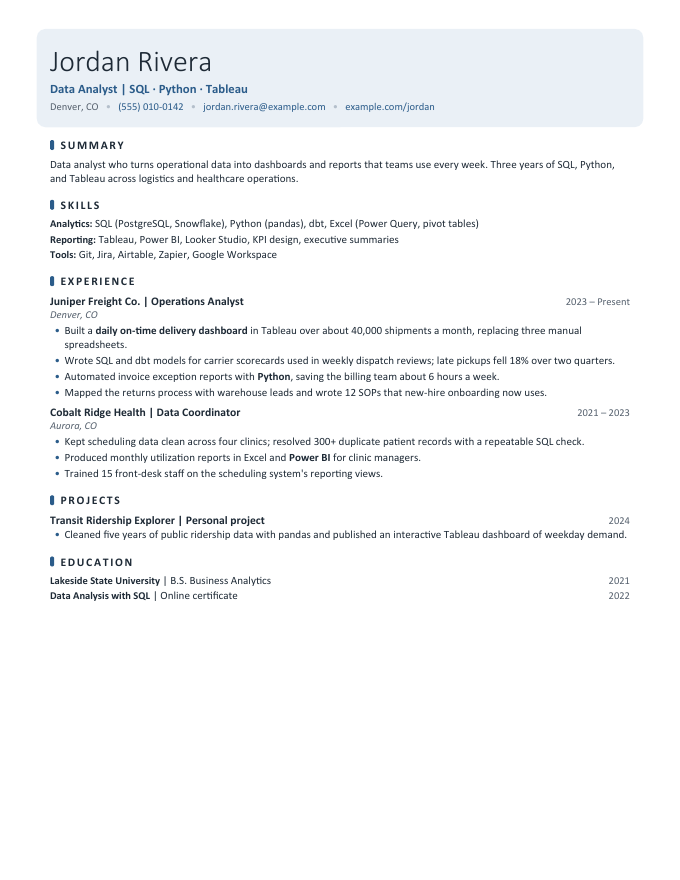
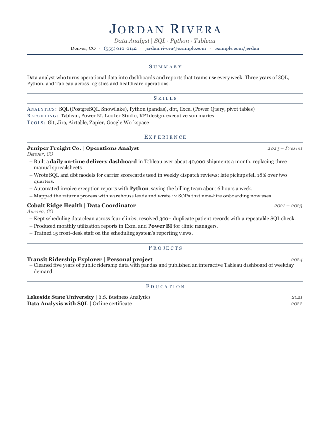
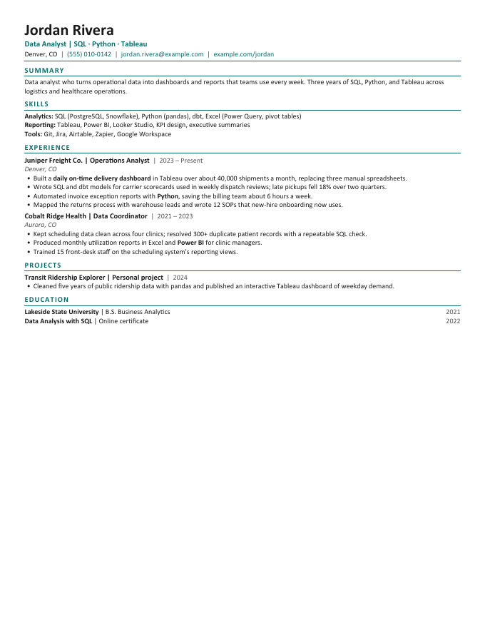
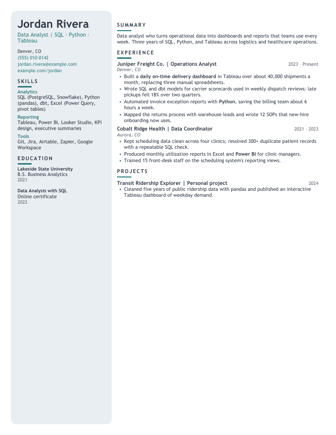
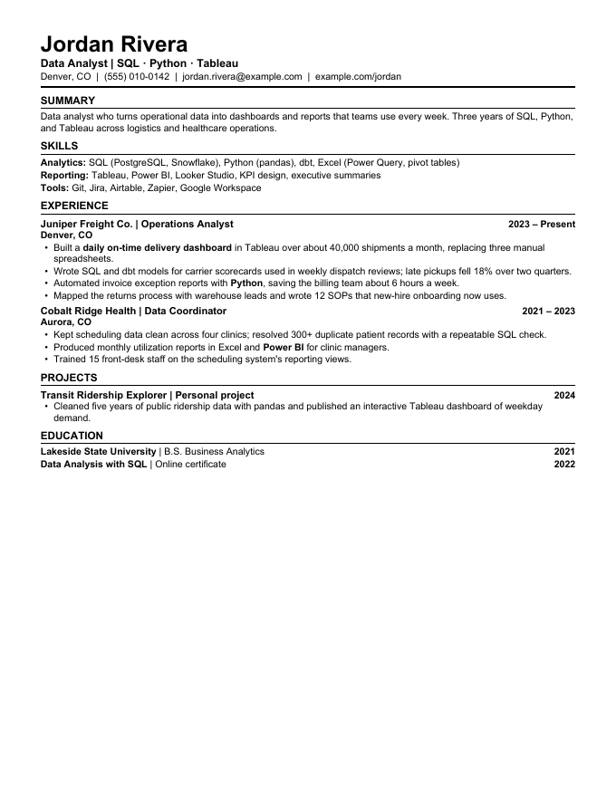

# factloom

Truthful, agent-driven job applications. You write every fact about your work once; factloom weaves those facts into tailored resumes, cover letters, and form answers, and an AI agent (Claude Code, Codex, or any agent that reads `AGENTS.md`) applies to jobs from your browser while recording everything it sends.

New resume batches default to [research-mode onboarding](.agents/skills/resume-builder/references/research-mode.md). The agent explains synthetic-content capabilities before drafting and offers adjustable research/enrichment controls or evidence-only for a real career resume. Existing batches retain their saved settings. Controls inherit across variants and tailored outputs; the CLI is unchanged. Research records preserve provenance while agreed blinded artifacts can look ordinary. Genuine source history remains intact, and external tests require company agreement and submission authorization.

| classic-blue | modern | executive |
|:---:|:---:|:---:|
|  |  |  |
| **compact** | **sidebar** | **plain** |
|  |  |  |

*Every resume above is built from the same facts file of a fictional person ([examples/demo](examples/demo)); only the theme differs. Themes are short YAML files you can copy and change: colors, fonts, type, corners, heading styles, and layout.*

## What it does

- **One source of truth.** Each claim lives once in `facts.yaml`. Resume versions (variants) pick and order facts for a kind of role; themes decide the look. Fix a typo once and every resume picks it up.
- **Starts from what you have.** Put available resumes in `drop/`: any format, any number of versions, even a scan, photo, or LinkedIn export. `./resumes import` archives and extracts them; the agent reads what no converter can and reconciles the versions with your existing evidence. It asks about material unresolved differences rather than rechecking facts you already settled. The resume-builder researches the target's actual work, recovers missing proof, and reviews role-specific drafts before delivery, with a fresh reader when available.
- **Claims stay reviewable.** Unconfirmed bullet phrases carry `confirm` flags that the build uses to mark the resume for review; tailoring refuses them by default. Other unresolved claims and pending approval belong in the guide's manual review items. These checks support source-based review; a generated `ready` status is not proof of truth or approval to send.
- **Applies for you.** Open job postings or job sites in the browser your agent controls and say "apply to the jobs open in my browser." The agent captures each posting, learns what the employer does, picks and tailors a resume, writes a cover letter when wanted, fills the form from your answers, submits or holds it, and records what it sent. It keeps going until you stop it, for weeks if you like: it rotates through searches for each target title on each job site, questions it cannot settle wait in one batch for you, and when the leads run out it widens the search and keeps watching for new postings. Where the agent's host can schedule it, it sets up the schedule itself after onboarding, unless you ask for a single session or another limit, running the repository's own prompt (`./resumes template automation-prompt`), a template you can change in one place.
- **Knows what to apply for.** Each resume version's guide is written from current research: the titles employers use, the seniority the facts support, pay, and saved searches that find those roles. `./resumes status` flags guides due for fresh research (every 90 days by default). Each posting gets a fit score: postings where you meet fewer than half the requirements, or that score below the minimum you choose in onboarding, are skipped.
- **Keeps your clock, if you allow it.** It answers start-date and availability questions from your notice period and interview hours, counted from the day of each application; offers and books interview times inside your windows, never sooner than your notice, with the time zone written out and your calendar checked for conflicts; reminds you before each interview; thanks the interviewer afterwards; and shows interviews and deadlines first in `./resumes status`.
- **Checks scam risk before progressing.** Posting and email screening keeps reviewable reasons, sources and dates, holds unresolved applications/follow-ups, and lets an agent resolve verified legitimate cases. Sender claims stay separate from employer identity; heuristic indicators never establish fraud. [Scam review workflow](.agents/skills/job-application/references/scam-screening.md).
- **Keeps an application history.** Each record carries verified employer addresses, country, hiring contact and method, alternate employer location, and job title. Dated events retain every contact, submission, interview round (scheduled, moved, cancelled, attended), hiring decision, planned/actual start, other status, and notes. Unknowns stay unknown; older records need no migration. `./resumes help app`, `./resumes help outcome`, and [the recording guide](.agents/skills/job-application/references/records.md) cover updates and exports.
- **Reads the replies, if you allow it.** It checks your mail for each application at the start of every activation and after each pass: it records rejections, completes follow-up forms from your answers, answers routine questions your answers settle (if you opt in), tells you at once about interviews and offers, and files what it has handled. Nothing is deleted.
- **Accounts and codes, if you allow it.** Onboarding asks who handles sign-ins and new accounts (you, or the agent with your password manager or with a password you type once per session into a hidden prompt), which email new accounts use, and who reads verification emails. You never edit a file for it. Whether a given agent will create accounts or type passwords also depends on that agent's own rules.
- **Asks once, then decides.** Each session starts with onboarding: the essential questions first (work authorization, pay floor and target, arrangement and travel limits, screening checks, terms, what rules a job out, how good a match to require), then the rest in batches while applications run, and only what your saved answers leave open. After that the agent decides from your answers and their defaults, and new questions from forms land in your inbox with the answer it used, so the next session already knows them.
- **Saves local checkpoints.** The agent checks the Git state and makes small conventional commits as coherent work accumulates, including at handoff. Git alone is enough; no GitHub CLI, upstream, or remote is required for local commits. It preserves unrelated edits, respects privacy checks, and reports blocked checkpoints. A push happens only when you explicitly request it, to the verified intended private remote. See [the checkpoint policy](AGENTS.md#local-checkpoints-in-consumer-work).
- **Keeps your data private.** Your people and settings live in your own private repository; a pre-push guard refuses to send them anywhere else.

## Quick start

You need [git](https://git-scm.com), [Node.js](https://nodejs.org) 22.18 or later, and [LibreOffice](https://www.libreoffice.org) for PDFs and for importing older formats (`.doc`, `.rtf`, `.odt`, `.pages`; without it, the agent reads those files itself or asks you for a PDF or Word copy). The [GitHub CLI](https://cli.github.com) makes the private copy in step 3 one command.

1. Clone this repository (do not fork it: a fork of a public repository is public, and so would your resume be).

   ```bash
   git clone https://github.com/DevGuyRash/factloom.git my-job-search
   ```

2. Set it up. The first run installs the tools' dependencies.

   ```bash
   cd my-job-search && ./resumes setup
   ```

3. Make your private copy on GitHub. This turns the engine into a read-only `upstream` you update from, and creates a private repository as `origin` for your data.

   ```bash
   ./resumes setup --private-repo my-job-search
   ```

4. Put every resume you have in `drop/`: any format, any number of versions, even a photo or a LinkedIn "Save to PDF". No resume yet is fine too.
5. Open Claude Code or Codex in the folder and say **"set me up"**. The agent explains the research-mode defaults and evidence-only choice, reviews all your existing context and source material, and invites extra general notes. It then recommends a document type and page limit, asks about meaningful preservation trade-offs, and manages the settings for you. It creates your profile, reconciles the sources (or builds from the material and scope you choose), and shows the result in a few themes. Existing batches keep their settings.
6. Optionally, say **"run a trial"** first: the agent applies, as a fictional person, to mock postings on your machine, and a grader checks what it submitted and skipped.
7. Open job postings in your agent's browser and say **"apply to the jobs open in my browser."**

On Windows, use `resumes.cmd` in place of `./resumes`, and enable Developer Mode before cloning so git can create the skill links (`git config --global core.symlinks true`), or use WSL.

## Make it yours

- **Themes.** `./resumes themes list` shows them, `./resumes themes preview --png` renders your resume in each with page counts, and `./resumes themes new mine --from modern` starts your own. A theme can extend another and change only what differs:

  ```yaml
  # custom/templates/themes/modern-teal.yaml
  extends: modern
  colors: { accent: "0F766E", tint: "E6F4F1" }
  corners: square
  headings: { style: band }
  ```

  Every setting is listed in [docs/themes.md](docs/themes.md). `./resumes themes check` warns about hard-to-read colors and fonts your machine lacks.
- **Tab completion.** `./resumes completion bash|zsh|fish|powershell` prints a script that completes commands, flags, and your people, resume variants, and themes as you type; [docs/completion.md](docs/completion.md) says where to load it.
- **Resume controls.** Tell the agent how much research, enrichment, title flexibility, keyword emphasis, tailoring, and review you want. It saves the [batch controls](shared/templates/documents/research-controls.yaml.hbs), applies explicit per-variant/tailored overrides, and keeps an evidence-only setting stronger than generation switches. Changing settings rebuilds selected outputs after review and archives superseded files while preserving retained active variants.
- **Content and page targets.** After reviewing the full context, the agent recommends a suitable format and length, including long CVs and project-based resumes. Choose a positive page limit or ask it to use judgment. Meaningful achievements and professional development stay part of the selection, including in research mode. Tell it any must-keeps or preferences; optional 1–5 weights can help explain priorities. It carries settled choices across the batch, recommends more room when useful, and asks about unresolved trade-offs. Hard employer limits take precedence over preferred length; conflicts with must-keeps need a decision. The existing `pages` setting fits the result by adjusting spacing, type, and margins; review readability rather than treating the 9 pt floor as a goal.
- **Applicant tracking systems.** Themes marked `ats: safe` are designed for simpler parsing; check each file's extracted text and rendered pages, and verify portal fields during an authorized application. No theme guarantees every ATS's behavior. The sidebar layout is marked `ats: caution`, for a person-first context.
- **Your own layer.** Put changes in `custom/` (themes, document templates, extra onboarding questions, scoring numbers, skill terms, site notes) or in `people/<you>/templates/`. They override the engine's defaults and survive every update.

## Privacy

- `people/` and `custom/` hold your data. They belong only in your private repository: the pre-push guard refuses to push them anywhere else, and refuses personal details in changes bound for the public engine. `./resumes doctor` warns if your repository is public.
- Street addresses and anything else you keep out of git go in `*.local.*` files, which git ignores. Session answers are kept in one of those too.
- Nothing in `drop/` is committed. When a resume is imported, lines the scan recognizes as personal details (a street address, a Social Security number, a labeled birth date, a card number, a key) go to git-ignored `.local` files, and any original the scan could not check is kept git-ignored on your computer.
- Portable evidence lives in tracked, sanitized imported notes in the person’s private repository, with attribution, dates and uncertainties. Guides and handoffs reference those notes, never gitignored originals or device-specific paths. Private local backups do not become a cross-device prerequisite.
- Government ID numbers, dates of birth, and bank details are never stored: you type them into the form yourself, and the agent holds the application for you.
- Passwords never go in tracked files. Your password manager fills them, or, if you choose, a password you type into a hidden prompt is kept in a git-ignored file for a single session and cleared at its end.
- The pre-commit hook scans staged files for personal data such as street addresses, card numbers, and keys.

## Updating

```bash
./resumes update
```

It merges the newest engine, reinstalls dependencies when they changed, runs the checks, and lists any of your resumes the new engine renders differently so you can rebuild and review them. It refuses to start if engine files were edited in your copy, and says how to move those changes into `custom/`.

## How it is organized

```
people/<person>/             your profile, answers, evidence, stories, inbox, applications (yours)
  resumes/source/            facts.yaml, variants/*.yaml, and saved batch controls
  resumes/active/<variant>/  the built resumes and a guide saying when to use each
custom/                      your themes, templates, settings, site notes, company research (yours)
shared/                      the engine's defaults: themes, templates, onboarding catalog, settings
tools/                       the command-line tools (./resumes help)
.agents/skills/              the job-application, resume-builder, and resume-reconciliation skills; .claude/skills and .codex/skills link here
drop/                        resumes you put in for import, in any format (git ignores its contents)
examples/demo/               a complete fictional person to try every command on
```

[AGENTS.md](AGENTS.md) is the agents' guide to the repository; [tools/README.md](tools/README.md) covers the tools, tests, and CI. Agents reach email through what their host provides (a mail connector or plugin, a webmail tab signed in to their browser, a mail MCP server) or through [himalaya](https://github.com/pimalaya/himalaya), a command-line email client.

Current resume guidance lives with the [builder](.agents/skills/resume-builder/SKILL.md): [intake and evidence](.agents/skills/job-application/references/intake.md), [research](.agents/skills/resume-builder/references/research.md), [writing](.agents/skills/resume-builder/references/writing.md), [file and content review](.agents/skills/resume-builder/references/review.md), and [controlled research mode](.agents/skills/resume-builder/references/research-mode.md). These references include relevant sources and their limits. Development history belongs in Git and pull requests.

## Contributing and license

Improvements to the engine are welcome; see [CONTRIBUTING.md](CONTRIBUTING.md), including how to contribute from your private copy without sending your data. Report security issues as described in [SECURITY.md](SECURITY.md). factloom is released under the [MIT License](LICENSE).
